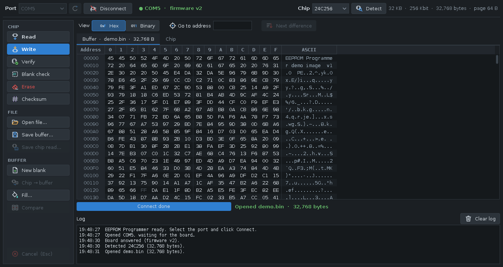
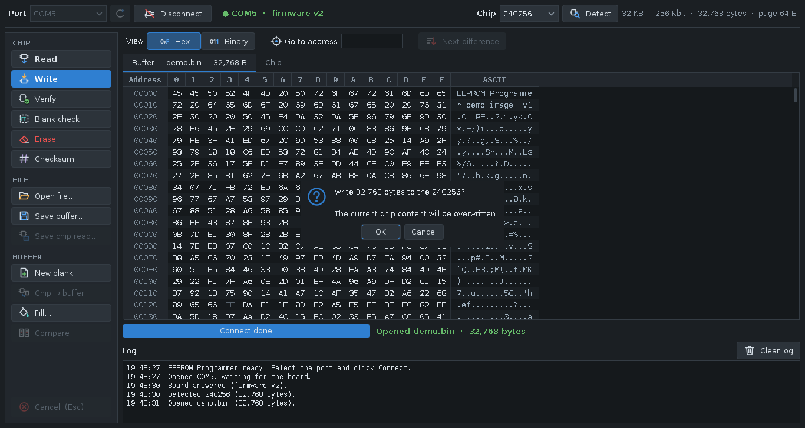
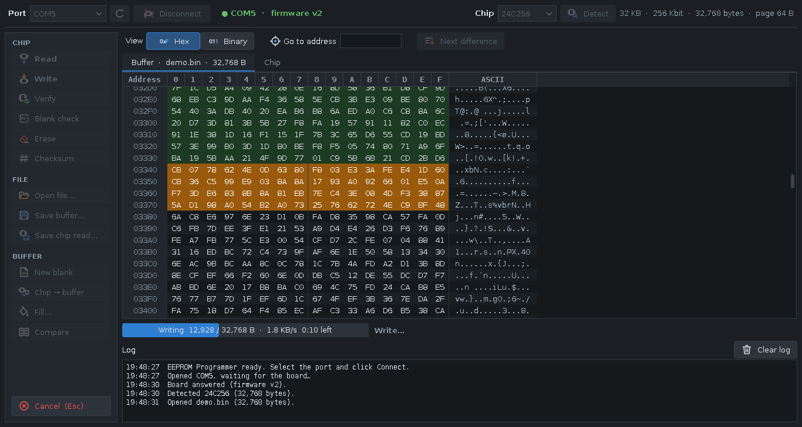
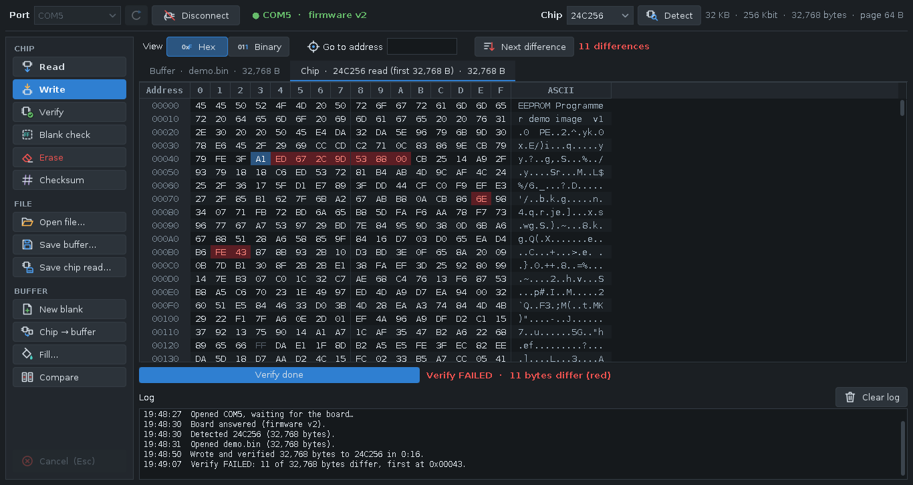
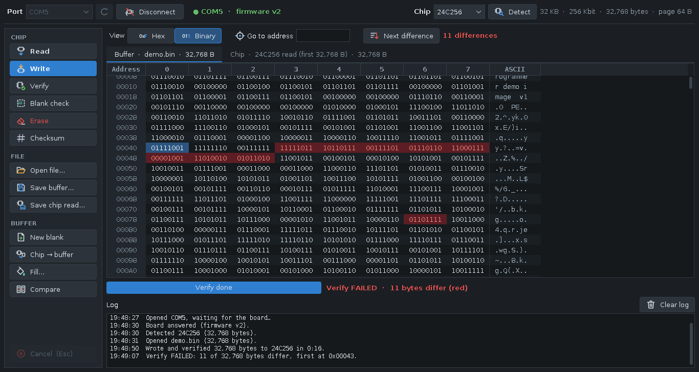

# Arduino I2C EEPROM Programmer

Read, write, verify and erase **24Cxx I2C EEPROMs** (24C01 – 24CM02) from your PC, using an **Arduino Nano** as the USB-to-I2C bridge.
It comes with a dark Java Swing desktop app with a live hex/binary view, auto chip detection and read-back verification.




## Features

- **Supports 12 chips:** 24C01, 24C02, 24C04, 24C08, 24C16, 24C32, 24C64, 24C128, 24C256, 24C512, 24CM01, 24CM02
- **Auto-detects the chip** when you connect. Detection only changes 2–3 bytes and restores them afterwards.
- **Fast page writes**: every block is read back and checked as it's written, so no separate verify pass is needed.
- **Read, Write, Verify, Blank check, Erase, and CRC-16 checksum** comparing the chip with your file.
- **Live progress in the hex view:** written bytes turn green, the block being sent turns orange, and you see speed and time left.
- **Difference highlighting:** bytes that differ between your file and the chip are shown in red, with a *Next difference* button to step through them.
- **Hex editor:** edit bytes in place, fill a range, go to an address, and switch between hex (16 bytes per row) and binary (8 bytes per row).
- **File formats:** `.bin` and Intel `.hex`, both open and save. You can also drag and drop files onto the window.
- **Safe to use:** confirmation before overwriting the chip, a size check against the selected chip, Cancel (Esc) at any time, and timeouts with automatic retries.
- **Dark UI** built with plain Swing: no external look-and-feel and no Nimbus. Sized to fit a 1366×768 screen.
- **One dependency:** [jSSC](https://github.com/java-native/jssc) for the serial port.

## Screenshots

| | |
|---|---|
|  |  |
| **Write confirmation**: shows how much will be written to which chip | **Writing**: green = done, orange = block being sent |
|  |  |
| **Verify**: differing bytes highlighted in red | **Binary view**: 8 bytes per row, differences still marked |

## Hardware

| EEPROM pin | Arduino Nano |
|---|---|
| SDA | A4 |
| SCL | A5 |
| VCC | 5V |
| GND | GND |
| A0, A1, A2 | GND |
| WP | GND (write enabled) |

Add 4.7 kΩ pull-up resistors on SDA and SCL if your EEPROM module doesn't have them.
The app expects A0–A2 tied to GND (device address `0x50`).

## Getting started

### 1. Flash the Arduino

Open `eeprom_programmer/eeprom_programmer.ino` in the Arduino IDE, select **Arduino Nano**, and upload.
No extra libraries are needed; it only uses `Wire`.

### 2. Build and run the app

The project is a NetBeans Java project (Java 8).

- **NetBeans:** open the folder as a project and press *Run*. The main class is `eepromprogrammer.Main`.
- **Built jar:** after *Clean and Build*, run

  ```
  java -jar dist/EEPROMProgrammer.jar
  ```

  Keep `dist/lib/jssc-2.9.2.jar` next to it.

### 3. Use it

1. Pick the serial port and click **Connect**. The Nano resets, and after about 2 s the app finds the board and detects the chip.
2. Click **Open file…** (or drag a file onto the window) to load a `.bin` or `.hex` file into the **Buffer** tab.
3. Click **Write**. Each block is written and read back.
4. Click **Read** to dump the chip into the **Chip** tab, then **Save chip read…** to save it as a file.

| Button | Shortcut | What it does |
|---|---|---|
| Read | F5 | Read the whole chip into the Chip tab |
| Write | F6 | Write the buffer to the chip, checking each block |
| Verify | F7 | Read the chip and compare it with the buffer |
| Blank check | | Check that every byte is `0xFF` |
| Erase | | Fill the chip with `0xFF` |
| Checksum | | CRC-16 of the chip, compared with the buffer |
| New blank | | New chip-sized buffer filled with `0xFF` |
| Chip → buffer | | Copy the last read into the buffer (for cloning or editing) |
| Fill… | | Fill an address range or the selected cells with a value |
| Compare | | Highlight differences between the buffer and the last read |
| Cancel | Esc | Stop the running operation |
| Open / Save | Ctrl+O / Ctrl+S | Load or save the buffer |
| Go to address | Ctrl+G | Jump to a hex address |

## Speed

These are typical estimates with a Nano at 115200 baud. Actual speed depends on the chip's write-cycle time.

| Chip | Read | Write + check |
|---|---|---|
| 24C256 (32 KB) | ~10 s | ~20 s |
| 24C512 (64 KB) | ~20 s | ~40 s |
| 24CM02 (256 KB) | ~1.5 min | ~2.5 min |

## Serial protocol

The firmware speaks a simple text protocol at 115200 baud: one command per line, with all numbers in hex.
You can use it from any serial terminal or your own software.

| Command | Reply | Description |
|---|---|---|
| `V` | `VER:2` | Firmware version |
| `P` | `PONG` | Ping |
| `T:<size>` | `OK` | Select chip by size in bytes |
| `S` | `SIZE:<size>` / `ERR:NOCHIP` | Auto-detect chip |
| `R:<addr>:<len>` | `D:<hexdata>:<sum>` | Read up to 64 bytes |
| `W:<addr>:<hexdata>:<sum>` | `OK` / `ERR:CHK` / `ERR:I2C` / `ERR:VERIFY:<addr>` | Page write with read-back check (up to 64 bytes) |
| `B:<addr>:<len>:<val>` | `OK` / `NE:<addr>` | Blank check |
| `F:<addr>:<len>:<val>` | `OK` / `ERR:…` | Fill / erase |
| `C:<addr>:<len>:<init>` | `CRC:<crc16>` | CRC-16/CCITT (init `FFFF`) |

`<sum>` is the 8-bit sum of the data bytes.

## Project structure

```
eeprom_programmer/
  eeprom_programmer.ino   Arduino firmware
src/eepromprogrammer/
  Main.java               entry point
  MainWindow.java         main window and all operations
  HexView.java            hex/binary table with progress and difference colours
  Programmer.java         firmware protocol (timeouts, retries, checksums)
  SerialLink.java         jSSC serial port, line based
  ChipType.java           supported chips
  HexFiles.java           .bin and Intel HEX load/save
  Theme.java              dark theme and flat UI painters
  icons/                  button icons and app icon (.png, .ico)
src/org/slf4j/impl/
  StaticLoggerBinder.java silences SLF4J's startup warning (bundled in jSSC)
lib/
  jssc-2.9.2.jar
```

## Troubleshooting

| Problem | Fix |
|---|---|
| *No answer from the board* | Upload the sketch. Close any other program using the port (e.g. the Arduino serial monitor). |
| *No chip detected* | Check wiring, pull-ups and that the chip is seated. You can still pick the chip by hand. |
| *Read-back mismatch* while writing | Tie WP to GND, select the right chip type, or the chip may be worn out. |
| Unreliable reads on very old 24C01/02 parts | Change `Wire.setClock(400000)` to `100000` in the sketch. |

## License

Released under the [MIT License](LICENSE).
